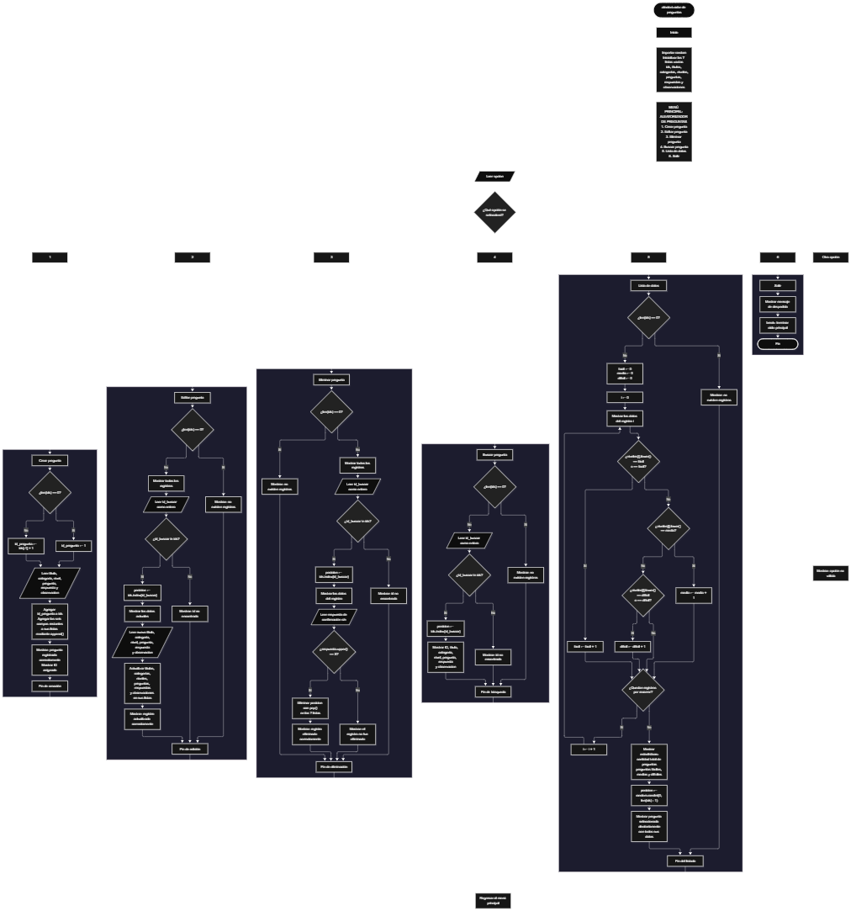

Este proyecto, llamado <b>aleatorizador de preguntas</b>, fue desarrollado en <b>python</b> como un ejercicio práctico para fortalecer la lógica de programación mediante la creación de un sistema de gestión y selección aleatoria de preguntas desde la consola. El programa cuenta con un menú principal de seis opciones que permite <b>crear, editar, eliminar, buscar y listar preguntas, además de seleccionar una pregunta aleatoriamente</b>. Cada registro almacena un identificador, un título, una categoría, un nivel de dificultad, el enunciado de la pregunta, su respuesta y una observación. Para organizar la información, se utilizan siete listas paralelas que mantienen relacionados los datos de cada registro durante la ejecución. Durante su desarrollo se aplicaron conceptos fundamentales de programación, como variables, listas, estructuras condicionales, ciclos repetitivos, búsqueda por identificadores, contadores, estadísticas y generación de números aleatorios. Este proyecto permite poner en práctica los conocimientos adquiridos en python y sirve como base para desarrollar sistemas de gestión de preguntas más avanzados.

<h2 align="center">⚙️ Funcionamiento del menú principal</h2>

### ➕ Crear pregunta

La opción <b>1) crear pregunta</b> permite registrar una nueva pregunta en el sistema. Antes de crear el registro, el programa comprueba si la lista <b>ids</b> está vacía mediante la condición <b>len(ids) == 0</b>. Si no existen registros, asigna el identificador inicial <b>id_pregunta = 1</b>. En caso contrario, genera el siguiente identificador utilizando la expresión <b>ids[-1] + 1</b>, tomando como referencia el último ID almacenado. Después, solicita el <b>título, la categoría, el nivel de dificultad, la pregunta, la respuesta y la observación</b>. Los datos se agregan a sus respectivas listas mediante el método <b>append()</b>, conservando la misma posición para cada campo del registro. Finalmente, muestra el mensaje <b>"pregunta registrada correctamente."</b> e informa el ID asignado. Esta operación permite incorporar nuevas preguntas a la colección durante la ejecución del programa.

### ✏️ Editar pregunta

La opción <b>2) editar pregunta</b> permite modificar la información de una pregunta registrada. Primero, el programa comprueba si existen registros mediante la condición <b>len(ids) == 0</b>. Si las listas están vacías, muestra el mensaje <b>"no existen registros."</b>. En caso contrario, recorre los registros utilizando un ciclo <b>for</b> y muestra sus identificadores, títulos, categorías, niveles, preguntas, respuestas y observaciones. Después, solicita el ID del registro que se desea editar y comprueba si existe mediante la condición <b>id_buscar in ids</b>. Si lo encuentra, utiliza <b>ids.index(id_buscar)</b> para obtener la posición correspondiente y mostrar los datos actuales. A continuación, solicita los nuevos valores de los seis campos descriptivos y actualiza las listas correspondientes. El identificador original se conserva. Finalmente, muestra el mensaje <b>"registro actualizado correctamente."</b>. Si el ID no existe, informa mediante el mensaje <b>"id no encontrada."</b>.

### 🗑️ Eliminar pregunta

La opción <b>3) eliminar pregunta</b> permite eliminar un registro mediante su identificador. Primero, comprueba si existen preguntas almacenadas. Si no hay registros, muestra el mensaje <b>"no existen registros."</b>. Si existen, presenta una lista de todas las preguntas con sus datos y solicita el ID del registro que se desea eliminar. El programa comprueba si el identificador está presente en <b>ids</b> y, cuando lo encuentra, obtiene su posición utilizando <b>ids.index(id_buscar)</b>. Después, muestra la información del registro y solicita confirmación mediante la pregunta <b>"¿desea eliminar este registro? (s/n):"</b>. Si la respuesta convertida a mayúsculas mediante <b>respuesta.upper()</b> es igual a <b>"S"</b>, elimina la posición correspondiente de las siete listas utilizando el método <b>pop()</b>. De esta manera, mantiene relacionados los datos restantes. Si se confirma la eliminación, muestra el mensaje <b>"registro eliminado correctamente."</b>. Si la respuesta es diferente de <b>"S"</b>, informa que el registro no fue eliminado. Cuando el ID no existe, muestra el mensaje <b>"id no encontrada."</b>.

### 🔎 Buscar pregunta

La opción <b>4) buscar pregunta</b> permite localizar un registro mediante su identificador. Antes de comenzar, el programa comprueba si existen preguntas almacenadas. Si las listas están vacías, muestra el mensaje <b>"no existen registros."</b>. En caso contrario, solicita el ID que se desea buscar y comprueba su existencia mediante la condición <b>id_buscar in ids</b>. Si encuentra el identificador, obtiene la posición con <b>ids.index(id_buscar)</b> y muestra todos los datos relacionados con la pregunta: identificador, título, categoría, nivel de dificultad, enunciado, respuesta y observación. Si no encuentra el registro, muestra el mensaje <b>"id no encontrada."</b>. Esta operación facilita consultar una pregunta específica sin necesidad de revisar manualmente todos los registros.

### 📋 Lista de datos y estadísticas

La opción <b>5) lista de datos</b> permite visualizar las preguntas registradas, calcular estadísticas por nivel de dificultad y seleccionar una pregunta aleatoriamente. Primero, comprueba si existen registros. Si no hay preguntas almacenadas, muestra el mensaje <b>"no existen registros."</b>. En caso contrario, inicializa los contadores <b>facil, media y dificil</b> con el valor <b>0</b> y recorre las listas mediante un ciclo <b>for</b>, mostrando los datos de cada pregunta. Durante el recorrido, utiliza la expresión <b>niveles[i].lower()</b> para comparar el nivel de dificultad sin distinguir entre mayúsculas y minúsculas. Los niveles <b>"fácil"</b> y <b>"facil"</b> aumentan el contador de preguntas fáciles; el nivel <b>"media"</b> aumenta el contador de preguntas medias; y los niveles <b>"difícil"</b> y <b>"dificil"</b> aumentan el contador de preguntas difíciles. Después, muestra la cantidad total de preguntas y los resultados de cada categoría. Finalmente, utiliza <b>random.randint(0, len(ids) - 1)</b> para seleccionar una posición aleatoria entre los registros existentes y muestra todos los datos de la pregunta seleccionada. Esta opción reúne el listado, el cálculo de estadísticas y la selección aleatoria en una sola operación.

### 🚪 Salir del menú principal

La opción <b>6) salir</b> permite finalizar la ejecución del programa. Cuando el usuario selecciona esta opción, el sistema muestra el mensaje <b>"gracias por utilizar el aleatorizador de preguntas."</b> y ejecuta la instrucción <b>break</b>, que interrumpe el ciclo principal <b>while True</b>. De esta manera, el programa deja de mostrar el menú y termina su ejecución. Si el usuario introduce una opción diferente de los valores comprendidos entre <b>1</b> y <b>6</b>, el bloque <b>else</b> muestra el mensaje <b>"opción no válida."</b> y permite volver al menú principal.

<h2 align="center">🧠 Temas aplicados en el proyecto</h2>

### 📦 Variables

En este proyecto se utilizan variables para almacenar los datos introducidos por el usuario, controlar las operaciones del menú, localizar registros, actualizar información y calcular estadísticas. Cada variable cumple una función específica dentro del sistema y permite organizar la información necesaria para ejecutar las distintas operaciones.

🔢 **Opcion:** Almacena la opción seleccionada por el usuario en el menú principal.

🆔 **Id_pregunta:** Guarda el identificador que se asigna al crear una nueva pregunta.

🔎 **Id_buscar:** Almacena el identificador introducido por el usuario para editar, eliminar o buscar un registro.

📍 **Posicion:** Representa el índice del registro localizado dentro de las listas.

📝 **Titulo, categoria, nivel, pregunta, respuesta y observacion:** Almacenan temporalmente los datos introducidos al crear una pregunta.

🔄 **I:** Funciona como contador para recorrer los registros durante las operaciones de edición, eliminación, listado y cálculo de estadísticas.

📊 **Facil, media y dificil:** Son contadores utilizados para calcular la cantidad de preguntas clasificadas según los niveles de dificultad reconocidos por el programa.

🎲 **Respuesta:** En la operación de eliminación, almacena la confirmación introducida por el usuario. En ese contexto, se utiliza para determinar si se debe eliminar el registro.

### 🗃️ Listas

El programa utiliza siete listas paralelas para almacenar y organizar la información de las preguntas. Cada lista contiene un campo específico y utiliza la misma posición para relacionar los datos de un mismo registro. Por ejemplo, la pregunta almacenada en la posición <b>0</b> de <b>preguntas</b> corresponde al título de la posición <b>0</b> de <b>titulos</b>, a su categoría en <b>categorias</b>, a su dificultad en <b>niveles</b>, a su respuesta en <b>respuestas</b> y a su observación en <b>observaciones</b>. El identificador correspondiente se encuentra en la misma posición de <b>ids</b>. Esta organización permite recorrer, buscar, modificar, mostrar y eliminar registros manteniendo relacionados sus datos.

🆔 **Ids:** Almacena los identificadores de las preguntas registradas.

📝 **Titulos:** Guarda los títulos de las preguntas.

🗂️ **Categorias:** Almacena las categorías asignadas a cada pregunta.

🎯 **Niveles:** Guarda los niveles de dificultad introducidos por el usuario.

❓ **Preguntas:** Contiene los enunciados de las preguntas.

💬 **Respuestas:** Almacena las respuestas correspondientes a cada pregunta.

📄 **Observaciones:** Guarda observaciones adicionales relacionadas con cada registro.

### 🔀 Estructuras condicionales

En el proyecto se utilizan las estructuras <b>if, elif y else</b> para seleccionar las operaciones del menú, comprobar si existen registros, verificar si un identificador está almacenado y determinar si se debe confirmar una eliminación. También se utilizan condiciones para clasificar las preguntas según el nivel de dificultad y para controlar las opciones introducidas por el usuario. Estas estructuras permiten que el programa ejecute diferentes instrucciones según los resultados de cada comprobación.

### 🔄 Estructuras repetitivas

El programa utiliza el ciclo <b>while True</b> para mantener activo el menú principal hasta que se seleccione la opción de salida. Además, utiliza ciclos <b>for</b> para recorrer las listas, mostrar los registros almacenados y calcular las estadísticas de dificultad. Estos ciclos permiten trabajar con todos los registros existentes sin tener que escribir instrucciones individuales para cada pregunta.

### 🎯 Selección de opciones

La selección de operaciones se realiza mediante una estructura condicional compuesta por <b>if, elif y else</b>. El valor almacenado en <b>opcion</b> determina cuál de los seis bloques de instrucciones se ejecuta. Cada opción corresponde a una operación del sistema, mientras que el bloque <b>else</b> informa cuando se introduce un valor que no coincide con ninguna opción disponible.

### 🔍 Búsqueda mediante identificadores

Para localizar los registros, el programa utiliza el operador <b>in</b> y el método <b>index()</b>. La expresión <b>id_buscar in ids</b> comprueba si el identificador existe en la lista, mientras que <b>ids.index(id_buscar)</b> devuelve su posición. Esta posición permite acceder a los datos relacionados de las demás listas para mostrarlos o modificarlos. El mismo procedimiento se aplica en las operaciones de edición, eliminación y búsqueda.

### 🧮 Contadores y estadísticas

La opción de listado utiliza las variables <b>facil, media y dificil</b> para contar las preguntas que corresponden a los niveles de dificultad reconocidos. Los contadores comienzan en cero cada vez que se ejecuta esta opción y aumentan cuando el valor de <b>niveles[i]</b> coincide con una de las categorías contempladas. Al finalizar el recorrido, el programa muestra la cantidad total de registros y el número de preguntas fáciles, medias y difíciles. Las preguntas que tengan otros valores en el campo de dificultad se incluyen en el total, pero no incrementan ninguno de estos tres contadores.

### 🎲 Generación de valores aleatorios

El módulo <b>random</b> se importa al inicio del programa para permitir la selección aleatoria de una pregunta. En la opción de listado, la instrucción <b>random.randint(0, len(ids) - 1)</b> genera un índice entero comprendido entre la primera posición disponible y la última posición ocupada. El índice generado se almacena en la variable <b>posicion</b> y se utiliza para mostrar los datos de la pregunta seleccionada. Como esta operación se ejecuta únicamente cuando existen registros, el intervalo de selección corresponde a las posiciones disponibles en las listas.

### 🔠 Manipulación de cadenas de texto

El programa utiliza los métodos <b>lower()</b> y <b>upper()</b> para comparar determinados valores de texto sin depender de la combinación de mayúsculas y minúsculas. En las estadísticas, <b>lower()</b> permite reconocer los niveles de dificultad contemplados independientemente de cómo se escriban sus letras en mayúsculas. En la eliminación, <b>upper()</b> convierte la respuesta de confirmación a mayúsculas para comprobar si es igual a <b>"S"</b>. Estos métodos facilitan el tratamiento de los datos introducidos por el usuario, aunque no validan automáticamente la ortografía ni todos los valores posibles.

<h2 align="center">¿Cómo se implementaron las operaciones crud en el proyecto?</h2>

Las operaciones <b>crud</b> se implementaron mediante las opciones del menú principal para administrar los registros de preguntas. La operación <b>crear</b> corresponde a <b>crear pregunta</b>, donde se introducen los datos de un nuevo registro y se agregan a las listas. La operación <b>leer</b> se realiza mediante <b>buscar pregunta y lista de datos</b>, que permiten consultar un registro por su ID o visualizar todas las preguntas almacenadas. La operación <b>actualizar</b> corresponde a <b>editar pregunta</b>, donde se modifican los campos descriptivos de un registro existente. Finalmente, la operación <b>eliminar</b> corresponde a <b>eliminar pregunta</b>, que solicita confirmación antes de quitar los datos de las listas. Estas operaciones se apoyan en identificadores, posiciones, condicionales y métodos de listas para administrar la información durante la ejecución del programa.

<h2 align="center">Diagrama de flujo del proyecto</h2>

<h2 align="center">🛡️ Validaciones y limitaciones del programa</h2>

### 📭 No existen registros

Esta comprobación se utiliza en las opciones de <b>editar, eliminar, buscar y lista de datos</b>. El programa evalúa la condición <b>len(ids) == 0</b> para determinar si existen preguntas almacenadas. Cuando no hay registros, muestra el mensaje <b>"no existen registros."</b> y evita continuar con la operación que requiere datos. En la opción de creación, esta misma condición se utiliza para determinar el primer identificador que se asignará.

### 🔎 Identificador no encontrado

En las operaciones de edición, eliminación y búsqueda, el programa comprueba si el identificador introducido se encuentra en la lista <b>ids</b>. Si existe, utiliza <b>ids.index(id_buscar)</b> para obtener la posición del registro. Si no existe, muestra el mensaje <b>"id no encontrada."</b>. Esta comprobación evita intentar acceder mediante ese identificador a un registro que no está almacenado.

### 🗑️ Confirmación de eliminación

Antes de eliminar una pregunta, el programa solicita confirmación mediante una entrada de texto. La condición <b>respuesta.upper() == "S"</b> determina si se ejecuta la eliminación. Si el usuario introduce la letra <b>"S"</b>, ya sea en mayúscula o minúscula, se elimina el registro de las siete listas. Cualquier otra respuesta evita la eliminación y muestra el mensaje <b>"el registro no fue eliminado."</b>. El programa no presenta otras opciones de confirmación específicas.

### 🎯 Clasificación de niveles de dificultad

La clasificación estadística reconoce los valores <b>"fácil", "facil", "media", "difícil" y "dificil"</b>, sin distinguir entre mayúsculas y minúsculas. No obstante, el programa no comprueba estos valores al crear o editar una pregunta. Por tanto, se pueden introducir otros textos, pero estos no incrementarán los contadores de preguntas fáciles, medias o difíciles. La cantidad total de preguntas seguirá incluyendo todos los registros almacenados.

### ⚠️ Entrada de identificadores

Durante las operaciones de edición, eliminación y búsqueda, el programa utiliza <b>int(input(...))</b> para convertir el identificador introducido en un número entero. Esta conversión permite comparar el valor con los identificadores almacenados, pero no contempla el tratamiento de entradas no numéricas. Si el usuario introduce texto que no puede convertirse a entero, puede producirse una excepción y detenerse la ejecución del programa.

### 🔢 Asignación de identificadores

El identificador inicial es <b>1</b> y, cuando existen registros, el siguiente ID se calcula mediante <b>ids[-1] + 1</b>. Este procedimiento funciona normalmente cuando se agregan registros consecutivamente, pero puede reutilizar un identificador si se elimina el último registro y posteriormente se crea una nueva pregunta. Por ejemplo, si los IDs son <b>1, 2 y 3</b>, se elimina el registro con ID <b>3</b> y después se crea otro, el nuevo registro puede recibir nuevamente el ID <b>3</b>. El programa no mantiene un contador independiente para garantizar que los identificadores nunca se reutilicen.

### 💾 Almacenamiento temporal

Los registros se almacenan en listas que existen únicamente durante la ejecución del programa. El código no utiliza archivos, bases de datos ni otros mecanismos de persistencia. Por esta razón, cuando el programa termina, la información almacenada en las listas deja de estar disponible para la siguiente ejecución. Para conservar los registros de forma permanente sería necesario incorporar posteriormente un mecanismo de almacenamiento.

<h2 align="center">🎯 Objetivo del proyecto</h2>

El objetivo principal de este proyecto es fortalecer la <b>lógica de programación</b> mediante el desarrollo de un sistema de gestión y selección aleatoria de preguntas en <b>python</b>. A través de su construcción se busca aplicar conocimientos sobre variables, listas, estructuras condicionales, ciclos repetitivos, búsqueda de registros, manipulación de cadenas de texto, contadores y generación de valores aleatorios. Además, el proyecto permite comprender cómo crear, consultar, modificar y eliminar información mediante una aplicación de consola, así como calcular estadísticas a partir de los datos almacenados. De esta manera, constituye una base para desarrollar herramientas educativas y sistemas de preguntas más completos utilizando otros lenguajes y tecnologías.

